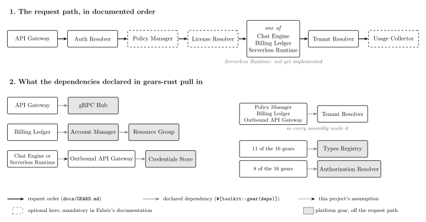

# Nextgear

**A neural network learns to predict, event by event, how an agent assembles Constructor Fabric's gears, and an exact Bayes oracle shows how close it comes to the best possible prediction.**

[](https://github.com/Negm2000/nextgear/actions/workflows/ci.yml)

| 86% | 89.4% | 24,910 / 24,910 | 1 command |
|:---:|:---:|:---:|:---:|
| of the way from a six-event baseline to the best possible score | of pass/fail verdicts predicted from events alone (n-gram: 66.1%) | assemblies on which the simulator agrees with Fabric's real registry | `python -m nextgear demo`, with no training |

A simulated agent builds an application from sixteen gears, one proposal at a time, and the platform's checks accept or reject each step. The rules are not invented. The request order comes from Fabric's documentation, and every dependency comes from the `deps` each gear declares in gears-rust. A one-layer GRU sees only the stream of events. An exact Bayes oracle averages over every possible hidden requirement and marks the best any such predictor can do.


*A held-out session. The dependency check rejects a Billing Ledger assembly that is missing three platform gears, and the agent repairs it. The middle panel shows the forecast made before each event (blue: GRU; outline: oracle); the right panel shows the oracle's belief about the hidden requirements. The session was chosen by a stated rule, not sampled: [`pick_hero_session`](src/nextgear/demo.py).*

## What it shows

1. **It predicts verdicts that depend on information it never sees.** From raw events alone, the GRU gets 89.4% of pass/fail verdicts right. A six-event n-gram gets 66.1%, a count model given the assembly directly 82.4%, and the exact oracle 91.5%.
2. **It gets most of the way to the best possible score.** On 2,000 held-out sessions it closes 86% of the log-loss gap between the best n-gram and the oracle; across three training seeds, 82–86%.
3. **It partly generalises to requirement combinations it never saw.** Trained without a combination, it still beats the n-gram on it in all nine runs (three combinations × three seeds). It gets 74.9% of pass/fail verdicts right on average, against 60.8% for the n-gram and 87.6% for a GRU that saw the combination, and it varies widely between seeds.
4. **It degrades when the agent changes.** A sloppier agent triples its distance from the oracle, from 0.035 to 0.105 nats per event, but it stays far ahead of both count models.

**Built with Constructor Fabric.**

- **Gears supplies the domain:** gear names, request order and dependency graph. A Rust harness checks the dependency rule against the real registry in CI.
- **Studio supplies the workflow:** requirements, decisions and specifications, linked to the code and validated in CI.

[How each was used](FABRIC_USAGE.md)

## Try it

With Python 3.12, in a fresh virtual environment:

```sh
python -m pip install -e .
python -m nextgear demo
```

The demo uses the checked-in models, so nothing is trained. It replays a test session and prints each forecast before revealing the event:

```text
    what happened              GRU top guess, before it happened   P(what happened):
                                                                      GRU  n-gram  oracle
 22 SUBMIT_ASSEMBLY            ✓ SUBMIT_ASSEMBLY            0.81     0.81    0.03    0.77
 23 EXTERNAL_CALL_VIOLATION    ✓ EXTERNAL_CALL_VIOLATION    0.99     0.99    0.37    0.92
 24 ADD_API_GATEWAY            ✗ ADD_OUTBOUND_API_GATEWAY   0.82     0.01    0.01    0.01
 25 ORDER_VIOLATION            ✓ ORDER_VIOLATION            1.00     1.00    1.00    1.00
 26 STEP_REVERTED              (routine step)
 27 ADD_OUTBOUND_API_GATEWAY   ✓ ADD_OUTBOUND_API_GATEWAY   0.92     0.92    0.96    0.76
 28 STEP_ACCEPTED              ✓ STEP_ACCEPTED              1.00     1.00    1.00    1.00
 29 ADD_CREDENTIALS_STORE      ✓ ADD_CREDENTIALS_STORE      0.81     0.81    0.61    0.76
 30 STEP_ACCEPTED              ✓ STEP_ACCEPTED              1.00     1.00    0.96    1.00
 31 SUBMIT_ASSEMBLY            ✓ SUBMIT_ASSEMBLY            0.77     0.77    0.71    0.76
 32 ASSEMBLY_ADMISSIBLE        ✓ ASSEMBLY_ADMISSIBLE        0.97     0.97    0.45    0.96
```

- **Event 22.** The GRU expects the submission; the n-gram cannot see that the assembly is complete.
- **Event 23.** The GRU predicts the external-call failure.
- **Event 24.** One of the agent's random mistakes, which no model could foresee.
- **Event 29.** The GRU expects the Credentials Store, which the outbound gateway declares as a dependency in gears-rust.

The demo then asks what the checks would have said to every gear the agent could have proposed instead.

## How it works



*What the agent assembles. The top row is the request path in documented order, and every grey arrow is a dependency that gears-rust declares.*

Each session draws a hidden specification (one execution gear, any of the dashed gears, a tight or loose latency budget) and an agent that is careful or sloppy and may not know about the outbound gateway or the platform dependencies. The agent proposes the gear it needs next, but picks another action 5% of the time if careful and 25% if sloppy. Local checks reject proposals out of order. The system check reports the first of: a missing gear, a missing dependency, an unguarded external call, an unneeded gear, or latency over budget. The agent then repairs the assembly and resubmits, until it passes or the agent runs out of budget. The probabilities, frequencies, check order, latencies and budgets are this project's assumptions. The [31 events](src/nextgear/events.py) and the [state machine](assets/states.svg) give every detail.

**The predictors.** The GRU sees event IDs only, never requirements, and is compared with three count models: frequency, n-grams with context chosen on validation data, and counts over the assembly reconstructed from events. The oracle reuses the generator's equations, so it is exact within the simulator but not independent evidence that the simulator is right. The [design](architecture/DESIGN.md) shows the modules and information boundaries.

A fixed event window forgets gears accepted before a run of rejections; one recurrent layer can carry that history and trains on a CPU.

## Results

Every forecast is judged right or wrong by its top guess (accuracy), and by the probability it gave what actually happened (log loss). Both are reported overall and separately for decisions, local checks and system checks, so routine steps cannot hide failures on the uncertain ones.

| Predictor | Log loss per event ↓ | Accuracy | System-check accuracy |
|---|---:|---:|---:|
| Best n-gram (6 events) | 0.7988 | 79.2% | 66.1% |
| Counts over the reconstructed assembly | 0.7350 | 81.4% | 82.4% |
| GRU, seed 0 | **0.5786** | **86.0%** | **89.4%** |
| Bayes oracle | 0.5434 | 86.9% | 91.5% |

The GRU's log-loss difference from the n-gram is −0.2202 nats per event, with a 95% interval of [−0.2273, −0.2128] from resampling whole sessions. Seed 0 is the first configured seed, not the best of the three.


*Excess log loss over the oracle. In (a) and (c) the oracle uses the priors that generated the sessions, so the bars are distances from the best achievable score. In (b) and (d) the sessions were selected after generation, which the oracle is not told about, so there it is a common reference, not the optimum.*


*Each combination was removed from training in turn. On overall log loss, the GRU that never saw a combination beats the n-gram in all nine runs, with every interval below zero ([all runs](results/REPORT.md#repeated-over-groups-and-seeds)).*

- **Repeated traces.** 628 of the 2,000 test sessions repeat a training session exactly. On the other 1,372, the GRU still beats the n-gram by 0.25 nats per event. This rules out recall of whole traces, not reuse of familiar prefixes.
- **Actions not taken.** For gears the agent did not propose, the GRU predicts the local verdict correctly 99.76% of the time.
- **Forced submissions.** These pass 4.7% of the time, and the GRU predicts 4.8% on average. A chosen submission is evidence that the agent thought the assembly was ready; a forced one is not. The oracle's log loss is 0.1174 when it treats forced submissions as observations and 0.0885 when it treats them as interventions. The GRU, trained on logs, scores 0.1776: predicting the next logged event is not the same as predicting the consequence of an action.

[Full benchmark](results/REPORT.md) · [Machine-readable results](results/report.json)

## Limits

- **The intervals are conditional** on the fitted models and the simulator. The analyses are exploratory, with no correction for multiple comparisons. The GRU's settings were chosen for an earlier version of the simulator and not re-tuned.
- **The unseen-combination result depends on the rules.** Under the first, hand-written rules the test failed: the retrained GRU's difference from the n-gram was +0.0068 [−0.0092, +0.0233]. The gears-rust dependencies replaced those rules, and were committed, before the runs reported here. All nine runs come from one simulator, so this is evidence about the simulator, not about real composition traces.

Next steps would be:

1. Exclude larger groups, such as everything built on one execution gear.
2. Try a state-aware probabilistic model.
3. Test on real composition traces.

## Reproduce

Create the environment with `python -m venv .venv`, activate it (`.venv\Scripts\Activate.ps1` or `source .venv/bin/activate`) and install as above. Datasets regenerate from fixed seeds in seconds.

```sh
python -m unittest discover -s tests -v
python -m nextgear --config configs/quick.toml --data-dir runs/quick/data --models-dir runs/quick/models --results-dir runs/quick/results all
```

The second command runs the whole pipeline at toy sizes. `python -m nextgear all` reproduces the recorded results; with 4 CPU threads on Linux it took 1,422 seconds for the main experiment and 2,398 for the repeated exclusion test.

- `all` overwrites the selected directories, so point it at `runs/` to keep the reference artifacts.
- `train`, `evaluate`, `sweep`, `demo` and `hero` also run on their own.
- `requirements-lock.txt` pins the library versions of the recorded run; results can still vary slightly across hardware.
- A settings stamp refuses checkpoints made with other settings. It does not detect edited data or code.

## Repository

| Path | Contents |
|---|---|
| `src/nextgear/` | Generator, check rules, extracted gear dependencies, predictors, oracle, evaluation, CLI |
| `tools/` | Dependency extraction from gears-rust and the Rust cross-check against its registry |
| `configs/`, `models/`, `results/` | Experiment settings, checkpoints, the report and figures |
| `architecture/` | [Requirements, decisions and feature specifications](architecture/) |
| `.cf-studio/` | Vendored Constructor Studio SDLC kit and its license |
