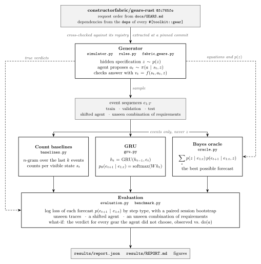

# Nextgear

**Can a model learn what happens when software components are assembled, rejected and repaired?**

Nextgear simulates an agent building a request pipeline from ten gears. A small GRU predicts the next event from the history alone. An exact Bayes oracle tells us how much uncertainty is unavoidable.



*One illustrative session, selected for a rejection, a failed check and a clear forecast of that failure. Blue bars are the GRU; outlines are the oracle. The right panel updates after the event. Aggregate evidence follows below.*

## What it learns — and where it fails

| Predictor | Log loss per event ↓ | Accuracy | System-check accuracy |
|---|---:|---:|---:|
| Best n-gram (6 events) | 0.7117 | 78.6% | 65.7% |
| Counts over engineered visible state | 0.6593 | 80.3% | 82.4% |
| GRU, seed 0 | **0.6196** | **81.1%** | 82.4% |
| Bayes oracle | 0.5850 | 82.3% | 84.7% |

On 2,000 test sessions, the GRU closes **73% of the n-gram's gap to the oracle**. Its paired log-loss difference from the n-gram is −0.0921, with a 95% session-bootstrap interval of [−0.0983, −0.0860]. Three training seeds give losses of 0.6168–0.6199.


*The reference uses matching priors in (a)–(c). In (d), it retains the base prior without knowledge of the selected requirement group.*

The harder tests matter. Of 2,000 test traces, 966 exactly repeat a training trace; the GRU also improves on the remaining 1,034. Changed agent behaviour raises its excess loss from 0.0346 to 0.0790. When a requirement combination is excluded from training and validation, the retrained GRU **does not establish an advantage over the n-gram** and predicts system verdicts much worse. Learning transferable composition rules remains an open problem.

[Full benchmark and intervals](results/REPORT.md) · [Machine-readable results](results/report.json) · [Constructor Fabric usage](FABRIC_USAGE.md)

## Try it

Use Python 3.12. From this directory, run `python -m venv .venv`, then activate with `.venv\Scripts\Activate.ps1` in PowerShell or `source .venv/bin/activate` on Linux/macOS:

```sh
python -m pip install -e .
python -m nextgear demo
```

The checked-in checkpoints need no training. Missing datasets regenerate from fixed seeds in a few seconds. The terminal demo prints each forecast before revealing the event, then tests alternative gear proposals and a forced submission.

```sh
python -m unittest discover -s tests -v
python -m nextgear --config configs/quick.toml --data-dir runs/quick/data --models-dir runs/quick/models --results-dir runs/quick/results all
```

Reproduce the recorded experiment with `python -m nextgear all`. The measured run took **503 seconds** with 16 CPU threads on Windows 11; runtime depends on hardware. `--threads 4` limits CPU use. Global options precede the command. `train`, `evaluate`, `demo --session 12` and `hero --out assets/session.svg` also run separately. `all` replaces datasets, checkpoints and results in the selected directories; use `runs/` paths to keep the reference artifacts.

`requirements-lock.txt` records the Windows CPU environment. For that environment, install it before `pip install -e .`; other platforms can resolve dependencies from `pyproject.toml`. Floating-point results can vary across hardware and PyTorch versions. The settings stamp catches configuration mismatches; it is not a file-integrity manifest.

If you edit dataset contents manually, retrain with `python -m nextgear train` before evaluating. If you change generator logic, remove `data/stamp.txt` to regenerate the splits, then retrain.

## The experiment

Each session has hidden requirements, a latency budget and agent traits. The agent proposes gears, receives deterministic local checks, submits an assembly and repairs failures. The [24 event descriptions](src/nextgear/events.py) define the prediction vocabulary. The generator imports no predictor; the GRU sees event IDs, never requirements or session IDs.



Public [Constructor Fabric gear documentation](https://github.com/constructorfabric/gears-rust/blob/60db50e2482d9eae1a78da6a4f6372579eb9d8e3/docs/GEARS.md) motivates the ordering and adapter constraints. The probabilities, requirement distribution, error policy, latency values, budgets and cache effects are authored assumptions. This is a controlled sequence-prediction experiment; no production gears or internal Fabric world model are executed. The [session state machine](assets/states.svg) shows the possible transitions. Diagram sources are real TikZ in `assets/*.tex`.

**Why a GRU?** A fixed window forgets accepted gears after later rejections or rollbacks. One recurrent layer can retain that history without hand-built rule features, and trains on a CPU. N-grams test whether the extra machinery helps; state counts test a stronger alternative that explicitly reconstructs the visible assembly. A transformer or graph model would add complexity before this simpler baseline is understood.

**What makes the evaluation convincing?** Splits use separate random streams and whole sessions. Context length and early stopping use validation data. Log loss and Brier score assess probabilities; scores are also separated into decisions, local checks and system checks so routine transitions cannot hide failures. The paired bootstrap resamples whole sessions, retaining dependence between events and recomputing the event-weighted difference. Intervals condition on fitted models and the simulator; they exclude neither simulator misspecification nor every source of training variation. These are exploratory experiments, not preregistered tests.

**Does it only exploit the generator?** Every model learns patterns in an authored simulator. Novel full traces rule out exact full-trace recall on that subset, but familiar prefixes and artificial regularities remain. The stronger state baseline, changed policy and excluded combination probe this problem; the negative combination result limits the claim. Real traces and independently implemented checks would be the next external test.

**Can it answer “what if”?** Local verdicts depend on the visible assembly, and the GRU gets 99.87% of untaken-gear verdicts right. Hidden requirements complicate submission: an agent choosing to submit is evidence it thinks it is ready. Forcing that action removes the evidence. The GRU predicts a 13.1% pass rate versus 9.3% observed; the oracle with the forced action represented as an intervention predicts 9.5%. Logged next-event prediction alone does not justify causal planning.

**What would improve it?** Start with the failed system checks: vary the excluded combinations and training seeds, sample boundary cases, and test a state-aware probabilistic model. Then add independent or real composition traces. A larger network only earns its place if it improves those tests.

## Code and Fabric

`src/nextgear/` contains the generator, pure checks, count models, GRU, oracle, evaluation and CLI. `configs/` fixes the experiment; `models/` contains four small checkpoints; `results/` contains one report and two figures. Generated datasets stay out of Git. The Studio SDLC kit and its license remain under `.cf-studio/`; requirements, decisions and four feature specs live in [architecture/](architecture/).

[FABRIC_USAGE.md](FABRIC_USAGE.md) explains the pinned tool version, validation command and what traceability does establish. GitHub Actions checks Windows and Linux with lint, tests, the small pipeline, packaging and Studio validation.
